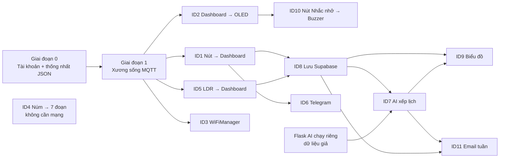

# Lộ trình làm Pomodoro Để Bàn – làm gì trước, làm gì sau

> Dựa trên proposal bản mới nhất (ID1–ID11). Mục tiêu là **dựng "xương sống" trước** (ESP32 ⇄ MQTT ⇄ Node-RED), sau đó mỗi chức năng chỉ là **cắm thêm** vào xương sống, không phải làm lại.

---

## 0. Bức tranh tổng thể: chức năng nào cần cái gì



**Quy tắc vàng**
1. **Thống nhất topic + JSON trước khi code** (mục 2). Đây là "hợp đồng" giữa ESP32 và Node-RED, để 2 người code song song mà ghép không vỡ.
2. **Làm 2 luồng cơ bản trước** (ID1 đi lên, ID2 đi xuống). Hai luồng này chạy thì mọi chức năng khác chỉ là thêm `type` hoặc thêm topic.
3. **Supabase (ID8) là nút thắt**: ID9, ID11 và phần huấn luyện của ID7 đều cần dữ liệu. Trong lúc chờ, Phát dùng **dữ liệu giả** để không bị kẹt.
4. Mỗi bước có mục **"Xong khi"**. Chưa đạt thì chưa chuyển bước.

---

## 1. Giai đoạn 0 – Chuẩn bị (cả 2, khoảng 1 buổi)

| Việc | Ai | Ghi chú |
|---|---|---|
| Tạo cluster **HiveMQ Cloud** (bản free), tạo 2 user: `esp32`, `nodered` | Khoa | Ghi lại host, cổng **8883** (TLS) |
| Tạo project **Supabase**, chạy file `schema.sql` (mục 3) | Khoa | Lấy `URL` + `service_role key` cho Node-RED |
| Cài **Node-RED** trên 1 laptop chính + các palette: `@flowfuse/node-red-dashboard`, `node-red-node-email`, `node-red-contrib-telegrambot` | Phát | Dashboard mở ở `localhost:1880/dashboard` |
| Cài **Arduino IDE** hoặc **PlatformIO** + thư viện (bảng dưới) | Cả 2 | |
| Tạo Python venv: `pip install flask numpy` | Phát | Cho ID7 |
| Tạo **1 thư mục project chung** (Git) | Cả 2 | Điểm làm nhóm = code tích hợp chung 1 project |

**Thư viện ESP32**

| Thư viện | Dùng cho |
|---|---|
| PubSubClient (Nick O'Leary) | MQTT |
| ArduinoJson (v7) | Đọc/ghi JSON |
| WiFiManager (tzapu) | ID3 |
| Adafruit SSD1306 + Adafruit GFX | ID2 OLED |
| TM1637Display (avishorp) | ID4 7 đoạn |
| WiFiClientSecure, time.h (có sẵn trong core ESP32) | TLS + giờ NTP |

**Cấu trúc thư mục gợi ý**

```
pomodoro/
├── firmware/          # code ESP32 (main.ino / main.cpp)
│   └── secrets.h      # WiFi, user/pass HiveMQ – KHÔNG đẩy lên Git
├── node-red/
│   └── flows.json     # Export từ Node-RED (Menu ☰ → Export)
├── ai-service/        # Flask: app.py, model.py, scheduler.py
├── supabase/
│   └── schema.sql
└── README.md
```

---

## 2. "Hợp đồng" MQTT – thống nhất trước khi code

| Topic | Chiều | JSON mẫu | Dùng cho |
|---|---|---|---|
| `pomodoro/state` | ESP32 → Node-RED | `{"dev":"pomo-01","ts":1732170000,"event":"start","state":"study","subject":"Toán","cycle":2,"total":4,"remain":1234}` | ID1, ID6, ID8 |
| `pomodoro/lux` | ESP32 → Node-RED | `{"dev":"pomo-01","ts":1732170002,"lux":1830}` | ID5, ID8 |
| `pomodoro/session` | ESP32 → Node-RED | `{"dev":"pomo-01","start_ts":1732168500,"end_ts":1732174500,"subject":"Toán","planned":4,"done":4,"focus_min":100,"completed":true}` | ID8 |
| `pomodoro/ack` | Node-RED → ESP32 | `{"start_ts":1732168500}` | ID8 |
| `pomodoro/cmd` | Node-RED → ESP32 | `{"type":"msg","text":"Con học bài nhé","sec":10}` | ID2 |
| | | `{"type":"subject","name":"Lý"}` | ID2 |
| | | `{"type":"beep","times":3}` | ID10 |

- `event` của `state`: `start` / `pause` / `resume` / `stop` / `phase_end` / `done`.
- `state`: `idle` / `study` / `break` / `paused` / `done`.
- `ts` là **Unix time (giây) lấy từ NTP** trên ESP32.
- `lux` gửi giá trị ADC thô (0–4095); Node-RED tự đổi sang % hoặc so ngưỡng.

---

## 3. Bảng Supabase (`supabase/schema.sql`)

```sql
create table events (
  id bigserial primary key,
  dev text, ts timestamptz not null,
  type text,              -- start/pause/stop/low_light...
  detail jsonb
);

create table sessions (
  id bigserial primary key,
  dev text, start_ts timestamptz not null, end_ts timestamptz,
  subject text, planned int, done int, focus_min int, completed boolean,
  unique (dev, start_ts)  -- gửi lại không bị trùng (upsert)
);

create table lux_readings (
  id bigserial primary key,
  dev text, ts timestamptz not null, lux_avg real   -- trung bình mỗi phút
);

create table plans (
  id bigserial primary key,
  week_start date, day date, start_time time, end_time time,
  subject text, cycles int, created_at timestamptz default now()
);

create table email_reports (
  id bigserial primary key,
  sent_at timestamptz default now(), to_email text, status text
);
```

---

## 4. Sơ đồ chân ESP32 gợi ý

| Linh kiện | Chân | Lưu ý |
|---|---|---|
| OLED SSD1306 | SDA **21**, SCL **22** | Địa chỉ I2C 0x3C |
| TM1637 (7 đoạn) | CLK **18**, DIO **19** | |
| Encoder KY-040 | CLK **32**, DT **33**, SW **25** | |
| Nút nhấn | **27** (INPUT_PULLUP, nút nối GND) | Chống rung khoảng 50 ms |
| LDR | **34** (ADC1) | ⚠️ **Không dùng chân ADC2** (0, 2, 4, 12–15, 25–27): ADC2 không đọc được khi bật WiFi |
| MOSFET D4184 → buzzer | Tín hiệu **26** | VIN = 5V (chân VIN/5V), OUT → buzzer, **GND chung** |

> Encoder SW đang ở chân 25 (ADC2), không sao vì đọc **digital**. Chỉ cảm biến **analog** (LDR) mới phải nằm trên ADC1.

---

## 5. Thứ tự làm từng bước

### Giai đoạn 1 – Xương sống MQTT (cả 2 · tuần 7)
Làm chung 1 lần, sau đó tách ra song song.

1. ESP32 kết nối WiFi (**tạm ghi cứng** SSID/pass trong `secrets.h`; ID3 làm sau).
2. Đồng bộ giờ NTP: `configTime(7*3600, 0, "pool.ntp.org")`.
3. Kết nối HiveMQ:
   - Dùng `WiFiClientSecure`. Lúc dev dùng `setInsecure()`, bản nộp thì gắn root CA.
   - Gọi `client.setBufferSize(1024)`. **Mặc định chỉ 256 byte, JSON dài sẽ bị cắt mà không báo lỗi.**
   - Mỗi bên một `clientId` riêng.
4. Node-RED: thêm node `mqtt in` (topic `pomodoro/#`) nối vào node `debug`, và node `mqtt out`.

✅ **Xong khi:** ESP32 publish `{"hello":1}` và thấy trong debug của Node-RED. Node-RED publish xuống thì Serial Monitor của ESP32 in ra.

### Giai đoạn 2 – Hai luồng cơ bản (song song · tuần 7)

| Khoa – **ID1** Nút → Dashboard | Phát – **ID2** Dashboard → OLED |
|---|---|
| Viết **máy trạng thái** đồng hồ: idle → study → break → … → done. Đếm bằng `millis()`, không dùng `delay()` | OLED: vẽ màn hình mặc định (đếm ngược, môn, chu kỳ), lấy dữ liệu từ biến trạng thái của Khoa |
| Nút: bấm = start/pause/resume, giữ 2 giây = stop; chống rung | `callback()` của MQTT: đọc `type` → `msg` hiện 10 giây rồi quay về; `subject` đổi môn |
| Mỗi lần đổi trạng thái → publish `pomodoro/state` | Node-RED: `text input` + `dropdown` môn + `button` → `function` → `mqtt out` |
| Node-RED: hiện trạng thái + nhật ký trên dashboard | |

> **Lưu ý ghép code:** cả 2 cùng sửa file ESP32. Thống nhất **1 biến trạng thái chung** (struct `Timer`) do Khoa giữ. OLED của Phát chỉ **đọc** biến này để vẽ.

✅ **Xong khi:** bấm nút trên hộp thì dashboard đổi trạng thái; gõ lời nhắn trên dashboard thì OLED hiện chữ.
➡️ **Ghép code lần 1**, cả 2 chạy trên cùng 1 ESP32.

### Giai đoạn 3 – Phần cứng trên hộp (song song · tuần 8)

| Khoa | Phát |
|---|---|
| **ID4** Núm → 7 đoạn: vặn chỉnh phút, nhấn chuyển sang chỉnh số chu kỳ (chạy offline, không cần mạng) | **ID10** Buzzer: thêm `type:"beep"` vào callback có sẵn → bật/tắt chân 26 theo `millis()` |
| **ID5** LDR → Dashboard: đọc chân 34 mỗi 2 giây → `pomodoro/lux` → gauge + ngưỡng chỉnh được + cảnh báo thiếu sáng | Node-RED: nút **"Nhắc nhở"** → `{"type":"beep","times":3}` |

✅ **Xong khi:** vặn núm thì 7 đoạn đổi số; che LDR thì gauge tụt và dashboard cảnh báo; bấm "Nhắc nhở" thì buzzer kêu.

### Giai đoạn 4 – Dữ liệu cloud (tuần 8–9) ← nút thắt

| Khoa – **ID8** Supabase | Phát – **ID7 phần AI** (chạy riêng, chưa cần Supabase) |
|---|---|
| Node-RED: `pomodoro/state` → bảng `events`; `pomodoro/lux` → gom trung bình mỗi phút → `lux_readings` | Viết `ai-service/` chạy độc lập với **dữ liệu giả** |
| `pomodoro/session` → **upsert** vào `sessions` (theo khóa `dev, start_ts`) → gửi `pomodoro/ack` | `scheduler.py`: tìm khung trống → chia buổi → CSP quay lui + MRV |
| ESP32: lưu tạm session chưa có ack (RAM hoặc LittleFS); có mạng lại thì gửi bù | `model.py`: logistic regression bằng numpy; sinh khoảng 200 phiên **giả lập** để huấn luyện ban đầu (cold start) |
| Gọi Supabase bằng node `http request` tới REST API: `POST {URL}/rest/v1/sessions`, header `apikey`, `Authorization: Bearer …`, `Prefer: resolution=merge-duplicates` | `app.py` (Flask, cổng 5000): `POST /schedule`, `POST /train`, `GET /scores`. Thử bằng Postman/curl |

> **Phát không phải chờ Khoa:** AI chạy được ngay với dữ liệu giả. Khi ID8 xong, chỉ cần đổi nguồn dữ liệu sang bảng `sessions`.

✅ **Xong khi:** học thử 1 phiên ngắn (chỉnh 1 phút) thì bảng `sessions` có 1 dòng và ESP32 nhận ack; gọi `/schedule` trả về lịch JSON hợp lệ.

### Giai đoạn 5 – Ghép dữ liệu vào giao diện (tuần 9–10)

| Khoa | Phát |
|---|---|
| **ID6** Telegram: `state == done` → node Telegram → điện thoại | **ID9** Biểu đồ: `http request` GET Supabase (lọc theo tuần/tháng) → `function` gom dữ liệu → `ui-chart` (phút/ngày, theo môn, độ sáng theo giờ) |
| **ID3** WiFiManager: thay WiFi ghi cứng bằng `wm.autoConnect("Pomodoro-Setup")` | **ID7 ghép:** trang Lịch học AI → Node-RED → `http request` tới Flask → bảng lịch → nút **Lưu** → bảng `plans`; nút **Huấn luyện lại** → `/train` lấy dữ liệu `sessions` thật |
| | Nhắc giờ học: `inject` mỗi 1 phút → kiểm tra `plans` → đến giờ thì gửi `beep` (dùng lại ID10) |
| | Thêm biểu đồ **Kế hoạch so với thực tế** (`plans` + `sessions`) |

> **Mẹo:** nếu Supabase chưa đủ dữ liệu thật để vẽ, chèn tay khoảng 20 dòng giả vào `sessions` để làm ID9 trước.
> **ID3 để cuối giai đoạn này:** lúc đầu ghi cứng WiFi cho dễ debug; xương sống đã ổn mới đổi sang WiFiManager.

✅ **Xong khi:** biểu đồ hiện đúng số liệu; xếp lịch xong bấm Lưu thì thấy trong `plans`; Telegram báo khi học xong; reset WiFi thì hộp phát "Pomodoro-Setup".

### Giai đoạn 6 – Email tuần (Phát · tuần 10)

- **ID11**: `inject` lặp 20:00 Chủ nhật (khi test thì dùng thêm nút **"Gửi thử"**) → truy vấn `sessions` + `plans` + `events` trong tuần → `function` dựng HTML → node `e-mail` (smtp.gmail.com, cổng 465).
- Gmail: bật **xác minh 2 bước** → tạo **App Password** → dán vào node e-mail.
- Gửi lỗi: `catch` → `delay` 30 phút → gửi lại. Ghi kết quả vào `email_reports`.

✅ **Xong khi:** bấm "Gửi thử" thì hộp thư nhận email có bảng số liệu tuần.

### Giai đoạn 7 – Lắp hộp và chuẩn bị vấn đáp (cả 2)

1. Test lại toàn bộ trên breadboard → **hàn lên phíp đồng** → lắp vào hộp in 3D.
2. Gộp flow Node-RED của 2 người vào 1 máy (Export → Import), đẩy `flows.json` lên Git.
3. Chạy demo theo kịch bản (mục 7). Đổi tên component Fusion theo ID mới.

---

## 6. Lịch tổng (theo bảng 3.2 của proposal)

| Tuần | Khoa | Phát | Cả 2 |
|---|---|---|---|
| 7 | ID1 | ID2 | Giai đoạn 0–1, ghép lần 1 |
| 8 | ID4, ID5, bắt đầu ID3 | ID10, bắt đầu ID7 (AI với dữ liệu giả) | Ghép lần 2 |
| 9 | ID8, ID6 | ID7 tiếp, ID9 | Ghép lần 3 |
| 10 | ID3 hoàn tất | ID7 ghép, ID11 | Hàn mạch, lắp hộp, chạy thử |

---

## 7. Kịch bản demo (thứ tự cho mượt)

1. Cắm điện → hộp kết nối WiFi (ID3) → OLED hiện màn hình chờ.
2. Vặn núm chỉnh 1 phút / 2 chu kỳ (ID4).
3. Bấm nút bắt đầu → dashboard đổi trạng thái (ID1).
4. Gõ lời nhắn trên web → OLED hiện (ID2). Bấm "Nhắc nhở" → buzzer kêu (ID10).
5. Che LDR → gauge tụt, dashboard cảnh báo (ID5).
6. Hết phiên → Telegram báo (ID6), Supabase có dòng mới (ID8), biểu đồ cập nhật (ID9).
7. Trang Lịch học AI → xếp lịch → Lưu (ID7).
8. Bấm "Gửi thử" email (ID11).

---

## 8. Lỗi hay gặp

| Triệu chứng | Nguyên nhân / cách sửa |
|---|---|
| ESP32 không nhận được JSON dài | Chưa gọi `setBufferSize()` cho PubSubClient |
| LDR luôn đọc ra 0 hoặc 4095 khi có WiFi | Đang dùng chân ADC2 → chuyển sang chân 34/35/36/39 |
| MQTT rớt kết nối liên tục | Code dùng `delay()` dài làm `client.loop()` không chạy; hoặc 2 thiết bị trùng `clientId` |
| Thời gian lưu Supabase sai 7 tiếng | Lưu `ts` dạng UTC và đổi sang `timestamptz`; chỉ cộng múi giờ khi hiển thị |
| Buzzer kêu yếu hoặc không kêu | Quên nối GND chung giữa ESP32 và module MOSFET |
| Node-RED gọi Supabase bị lỗi 401 | Thiếu header `apikey` hoặc sai key |
| Gmail từ chối đăng nhập | Dùng mật khẩu thường thay vì App Password |

---

## 9. Lưu ý sửa proposal (để khớp lúc làm)

- **ID2:** proposal vẫn ghi *"đến giờ học trong lịch, OLED hiện…"* và *"khi phòng thiếu sáng, OLED hiện lời nhắc bật đèn"* → nên xóa, vì luồng cơ bản chỉ gồm lời nhắn và chọn môn từ web.
- **ID10:** xóa cụm *"(kèm lời nhắc bật đèn trên OLED)"*.
- **Bảng điểm mục 4:** tổng đang là 12,5 / 12,0 → điểm nâng cao chỉ tính tối đa 4,0, tổng tối đa 10,0.
